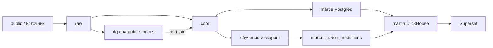

# Smart Logistics: коридор ставок и пакетный прогноз

Слоистый конвейер для тестового задания: сырой срез, карантин как dead-letter, ядро в PostgreSQL, витрина в PostgreSQL и ClickHouse, пакетный скоринг.

## Как устроены слои

`dq` — не шаг между raw и core. Это боковой контур качества: строки, которые нельзя класть в рынок, остаются там с кодом причины и не пропадают. Core строится из raw и отсекает любой `source_price_id`, который есть в карантине. Витрины из карантина не читают.



| Схема | Что хранит | Кто пишет |
|---|---|---|
| `raw` | Срез источника. Факты заменяются по окну `loading_date`, справочники перечитываются целиком | Python |
| `dq` | `quarantine_prices`, аудит батча, результат Great Expectations | Python |
| `staging`, `intermediate`, `core` | Принятые цены в RUB, одна строка города на `gc_id`, мост цена × группа кузова | dbt |
| `mart` | Карточка маршрута и таблица факт/прогноз | dbt и скоринг |

Имя из задания `dq_quarantine_prices` сохранено как представление `dq.dq_quarantine_prices` над физической таблицей `dq.quarantine_prices`. На одну цену приходится одна строка на каждый код причины.

`outlier_mark` в карантин не пишет. Такие сделки остаются в core и не входят в коридор и в обучение. Сделки за 26 октября 2026 в генераторе ещё не размечены ночным джобом: у них `outlier_mark = false`, это ограничение источника, а не пропуск правила.

Дополнительная метка `recomputed_outlier` повторяет `MarkOutlierPrices` и не заменяет `outlier_mark`. Она считается только по принятым фактам с `price_group_id`, `price > 0` и `distance > 0`. Группа меньше четырёх строк не размечается. Внутри группы непрерывные перцентили: сырой `price` вне `Q1 - 1.5 * IQR` … `Q3 + 1.5 * IQR`, либо сырой `price / distance` вне P5–P95. Достаточно одного из двух условий. Границы включают саму строку, как ночной джоб по снимку, и не пересчитываются на train. Флаг не попадает в признаки. Коридор и обучение отбрасывают строку, если истинна любая из двух меток.

Одинаковые города погрузки и разгрузки не отбраковываются.

## Что делает каждый инструмент

- **uv** ставит зависимости из `uv.lock`.
- **Pydantic** держит настройки и проверяет, что начало окна не позже конца.
- **SQL** раскладывает карантин по соединениям со справочником городов и курсом. Это тот же набор причин, что в `etl/quality/rules.py`.
- **dbt** собирает core и витрину. Месяц берётся из `price_dates`. MoM и YoY смотрят только на соседний календарный месяц.
- **Pandera** проверяет матрицу модели. Лишняя колонка, включая `price_rub`, валит контракт.
- **Great Expectations** проверяет уже собранный core: обязательные поля заполнены, `price_id` уникален, число строк равно `raw` минус карантин, а у строк без обеих меток выброса ставка за километр не выше 2 000 руб. Грязный raw ожидаем, поэтому сьют не ставится на вход.
- **CatBoost** — основная модель. **Ridge** — линейный бейзлайн, **DecisionTreeRegressor** — древесный (`max_depth=12`, `min_samples_leaf=50`). Imputer, one-hot и scaler у линейной модели учатся только на train. Дерево не масштабируется.
- **ClickHouse** хранит копию витрины и прогнозов для BI. Публикация делает `TRUNCATE` и вставку, чтобы повтор не удваивал строки.
- **Airflow** вызывает те же команды CLI. Расписание ручное: первый прогон делает сервис `pipeline`, повтор окна запускается из UI.
- **Superset** читает ClickHouse.

`price_group_id` приземляется в `raw.prices` как поле источника и не попадает в staging. В признаки не входят ставка, ставка за км, НДС, маржа и групповые статистики.

## Окно обучения

`as_of` зафиксирован как `2026-10-26`, а не как дата запуска.

- train: с 26 июля 2026 включительно до 5 октября не включая
- test: с 5 октября по 26 октября включительно
- будущие погрузки (`loading_date > as_of`) скорятся, а `actual_price_rub`, абсолютная ошибка и APE остаются пустыми

## Запуск

Нужны Docker и свободные порты 5432, 8123, 8080, 8088. Пароли в `.env.example` только для локального compose.

```bash
docker compose up --build
```

Первый старт Postgres включает генерацию 300 000 сделок, затем сервис `pipeline` прогоняет окно `2023-01-01` … `2027-12-31`.

После этого:

- Airflow: <http://localhost:8080>, `admin` / `admin`, DAG `tariff_pipeline`
- Superset: <http://localhost:8088>, `admin` / `admin`, дашборд <http://localhost:8088/superset/dashboard/tariffs/>. «Сеть маршрутов» — сводная таблица. «Карточка маршрута» — помесячный коридор выбранного направления; фильтры по умолчанию стоят на Москва → Тула, тент, FTL.
- метрики последнего прогона на синтетике (train 22 882, test 11 921, после отсечения обеих меток выброса):

| Модель | R² | MAPE | RMSE, руб. | MAE, руб. |
|---|---:|---:|---:|---:|
| CatBoost | 0.923 | 14.91% | 52 982 | 26 995 |
| Decision tree | 0.915 | 15.00% | 55 694 | 28 637 |
| Ridge | 0.842 | 49.68% | 76 018 | 47 787 |

Повтор того же окна идемпотентен: delete и insert по одной и той же дате погрузки. Своё окно:

```bash
python -m etl.cli run-all --start-date 2026-09-01 --end-date 2026-09-07
```

Локально без Docker:

```bash
uv sync
uv run ruff check etl ml dags tests
uv run pytest
```

Проверки стиля: Ruff, длина строки 100, импорты, pyflakes. Публичные функции с docstring.

## Полезные запросы

```sql
SELECT reason_code, count(*)
FROM dq.quarantine_prices
GROUP BY 1
ORDER BY 2 DESC;

SELECT model_name, r2, mape_pct, rmse, mae, train_rows, test_rows
FROM mart.ml_run
ORDER BY model_name;

SELECT price_month, loading_city_name, unloading_city_name, body_group,
       weight_category, median_trip, trips_count, reliability_level, mom_pct
FROM mart.mart_route_card
WHERE reliability_level = 'HIGH'
ORDER BY trips_count DESC
LIMIT 20;
```
